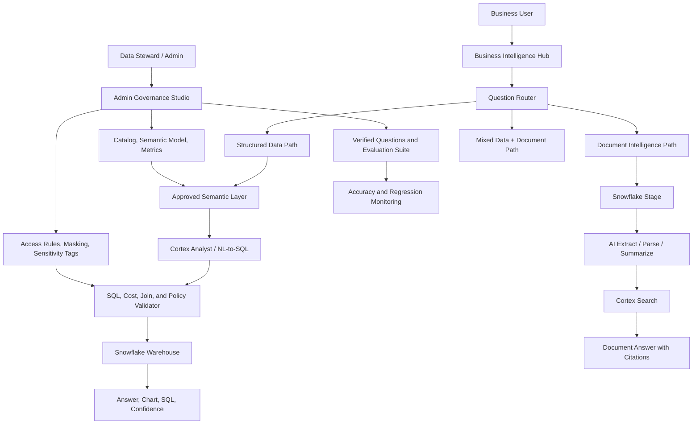

# ContextGuard AI

# Governed Enterprise Intelligence Hub

## Proof of Concept, Technical Proposal, and Training Blueprint

**Version:** 2.0  
**Date:** July 2, 2026  
**Primary POC Path:** Snowflake-first  
**Future Expansion:** BigQuery, GCP/AWS/Azure-agnostic architecture  
**Project Goal:** Build a production-minded AI analytics platform that lets business users ask natural-language questions across structured data and documents while reducing hallucinations and enforcing privacy, governance, and access control.

---

## 1. Executive Overview

Business users across large organizations need answers from enterprise data every day. They ask questions such as why revenue dropped, which region is underperforming, what documents contain a specific obligation, or whether an operational metric is trending in the wrong direction. In many organizations, these users cannot answer those questions directly because they do not know SQL, do not understand the underlying schemas, and cannot safely browse sensitive tables that may contain PHI, PII, financial data, or confidential operational information.

The usual workflow is slow. A business user asks a data analyst. The analyst identifies the right tables, writes SQL, validates joins, checks filters, creates a chart, and sends the result back. This process may take hours or days. When AI is added casually, a new risk appears: the model may generate incorrect SQL, join the wrong tables, invent fields, expose sensitive columns, or provide confident but false answers.

ContextGuard AI is designed to solve this problem as a governed enterprise intelligence hub. The platform allows business users to ask questions in natural language, receive SQL-backed answers, view automatic charts, search and summarize documents, and operate within strict governance boundaries. The platform is not a free-form chatbot over a database. It is a controlled intelligence system that combines semantic modeling, access control, query validation, data quality awareness, document intelligence, and evaluation.

The recommended first implementation is Snowflake-first. Snowflake gives us a practical way to build a serious POC quickly because it already provides native capabilities such as Cortex Analyst, Cortex Search, Cortex COMPLETE, AI Functions, Stages, Dynamic Tables, role-based access control, masking policies, and row access policies. After the Snowflake POC is successful, the same product concept can be extended to BigQuery and then generalized into a cloud-agnostic platform.

---

## 2. Problem Statement

The core business problem is not simply “business users need dashboards.” The deeper problem is that enterprise knowledge is trapped across tables, schemas, metrics, documents, logs, and tribal knowledge. Users need answers, but the path to the answer is technically and organizationally complex.

A realistic enterprise environment includes clean tables, dirty tables, old tables, views layered on top of other views, inconsistent definitions, semi-structured logs, PDFs, scanned files, spreadsheets, and sensitive records. A user may ask a simple question such as “What was revenue last month by region?” but the system must know which revenue definition is official, which records should be excluded, what timezone defines “last month,” whether test accounts should be removed, whether currency conversion is required, and whether the user has permission to see the result.

Current natural-language-to-SQL systems often perform well with one or two clean tables. Accuracy falls when more tables are added because the model has too many possible joins, similar column names, weak metadata, and unclear business definitions. The platform we build must solve the multi-table reasoning problem using governance and semantic structure, not only prompting.

---

## 3. Business Challenges Resolved

ContextGuard AI resolves several business challenges at once.

First, it reduces dependency on data teams for routine analysis. Business users can ask questions directly and receive governed answers without waiting for a custom SQL request. This does not remove the data team; it elevates them into stewards of trusted metrics, semantic models, and governance.

Second, it improves decision speed. Executives, managers, analysts, and operations teams can move from question to answer in minutes instead of days. The platform can also provide automatic visualizations, reducing the need to manually configure BI charts.

Third, it reduces hallucination risk. The AI is not allowed to freely inspect all raw tables and guess joins. It uses approved semantic models, verified examples, certified metrics, role-aware policies, and SQL validation.

Fourth, it protects sensitive data. The system enforces role-based access, row-level controls, masking policies, document sensitivity labels, and audit logs. This is essential for healthcare, finance, HR, insurance, and any organization handling confidential business data.

Fifth, it creates consistency in business definitions. Revenue, margin, churn, active customer, readmission rate, or claim approval rate should not mean different things in different dashboards. The semantic layer becomes the shared contract between data teams and business users.

Finally, it brings structured data and unstructured documents into one intelligence experience. Users should be able to ask questions over both warehouse tables and documents such as contracts, policy PDFs, operational reports, invoices, or compliance files.

---

## 4. Product Vision

ContextGuard AI should feel like a secure enterprise intelligence workspace, not a generic AI chat window. The product has two primary experiences.

The first experience is the Business Intelligence Hub. This is where a business user asks questions, reviews answers, sees charts, uploads or searches documents, and explores persona-specific dashboards. A sales leader might ask about regional revenue. A finance analyst might compare margins. A compliance officer might inspect sensitive access patterns. A healthcare operations manager might ask about readmission trends while only seeing data they are allowed to access.

The second experience is the Admin Governance Studio. This is where data teams and administrators control the system. They approve tables, define metrics, manage semantic relationships, classify sensitive fields, configure access policies, upload verified questions, monitor accuracy, and review audit logs. This part is critical because enterprise AI succeeds only when business logic and security are governed.

Together, these two applications form the actual product. The business app creates self-service value. The governance studio creates trust.

---

## 5. Proposed Architecture

The architecture follows a governed AI pattern. A user question does not go directly to a large language model with unrestricted database access. Instead, the question is routed through semantic context, policy checks, query generation, validation, execution, answer generation, and audit logging.

The important architectural principle is controlled reasoning. The AI may reason about the user’s intent, but it must operate inside boundaries defined by semantic models, approved joins, security policies, and validation rules.

---

## 6. Recommended Implementation Path

The project should be built in three large stages.

### Stage 1: Snowflake-First POC

The first stage proves that the product works using Snowflake as the primary data and AI platform. This path is recommended because Snowflake provides many of the capabilities that would otherwise require separate infrastructure.

The Snowflake POC will include natural-language questions over structured data, semantic models, automatic charts, PDF/document upload, semantic document search, document Q&A, role-based access control, masking policies, row access policies, dirty data examples, and an accuracy evaluation suite.

### Stage 2: BigQuery / GCP Path

After Snowflake works, the second stage recreates the same product pattern using BigQuery and Google Cloud services. This proves that the product is not dependent on Snowflake alone. The BigQuery version will require more custom engineering because we will need to build or configure semantic-layer retrieval, Gemini/Vertex AI workflows, Document AI integration, and BigQuery-specific policy handling.

### Stage 3: Cloud-Agnostic Enterprise Platform

After Snowflake and BigQuery are both working, the third stage abstracts the system into provider adapters. This allows the same application to support Snowflake, BigQuery, Redshift, Databricks, or Azure Synapse. This is not needed for the first POC, but it is a strong future direction for an enterprise-grade product.

---

## 7. Technology Stack

The recommended Snowflake-first stack is intentionally practical.

The frontend should use Next.js, TypeScript, Tailwind CSS, shadcn/ui, and Recharts or Apache ECharts. This gives us a modern, clean, dashboard-ready application that can support both the business hub and admin governance studio.

The backend can start with Next.js API routes for simplicity. If the backend grows more complex, especially for document processing, evaluation workflows, or provider abstraction, FastAPI can be introduced as a dedicated service. Starting simple is better for the POC; over-engineering the backend too early will slow us down.

Snowflake will be the primary warehouse, AI engine, and governance platform for the first path. We will use Cortex Analyst for natural-language-to-SQL, Cortex Search for semantic document retrieval, Cortex COMPLETE for answer generation and summarization, Snowflake AI Functions for extraction/classification/summarization, Snowflake Stages for file upload, Dynamic Tables for incremental derived datasets, and Snowflake governance features for access control.

GitHub and Jira will be used for collaboration. Cursor and Codex will be used as AI-assisted engineering tools. Tavily may be used for research and article discovery. Hugging Face can be used for datasets and model experiments. Featherless can be used later for open-source model testing. Lovable can be used only for quick UI ideation or mockups, not as the production foundation.

---

## 8. Tool Decisions

### Tools We Will Use

Snowflake is the primary platform for the first POC because it provides warehouse-native AI and governance. Cortex Analyst is a strong fit because it performs natural-language-to-SQL over a semantic layer rather than asking a model to guess directly from raw tables. Cortex Search and Cortex COMPLETE are useful for document intelligence. Snowflake Stages simplify file upload and storage inside the warehouse ecosystem.

Next.js and TypeScript are the right application foundation because the product needs a polished business UI, admin screens, API routes, and maintainable frontend logic. Tailwind and shadcn/ui allow us to build a professional dashboard experience quickly. Recharts or ECharts will support automatic chart generation.

GitHub and Jira are required for a realistic collaborative workflow. Cursor and Codex help demonstrate AI-assisted engineering. Tavily is useful for collecting external research and documentation. Hugging Face is useful for synthetic data, public datasets, and later model experiments.

### Tools We May Use Later

FastAPI may be introduced if backend services become complex. MCP servers may be introduced after the first POC to create clean tool boundaries for Snowflake, BigQuery, policy checks, evaluation, and document intelligence. LangGraph or another controlled workflow framework may be introduced later for agentic routing and validation.

Featherless may be useful when we want to compare open-source models without managing GPUs. Lovable may be useful for visual prototyping, especially if we want to show that we used modern AI product-building tools, but it should not own the production security logic.

### Tools or Approaches We Will Avoid in the Initial POC

We will not use a raw LLM directly over all tables because that creates hallucination and security risk. We will not allow a fully autonomous agent to execute unrestricted SQL. We will not upload real PHI or PII during the POC. We will not commit secrets or API keys to GitHub. We will not build a custom natural-language-to-SQL engine before testing Snowflake Cortex Analyst because that would slow the first POC and duplicate native Snowflake capabilities.

---

## 9. Proposal Options and Maturity Levels

The earlier 15 proposals should not be understood as 15 unrelated products. They represent different levels of maturity, different budget profiles, and different implementation paths for the same larger product vision.

### Proposal 1: Zero-Budget Prototype

This version proves the concept with minimum cost. It can use local development, sample data, basic Snowflake trial usage, simple semantic definitions, and a lightweight Next.js or Streamlit interface. It is useful for learning and early validation, but it is not enterprise-ready.

Estimated timeline: 2 to 3 weeks.  
Team size: 1 to 2 people.  
Best use: early proof, academic demo, personal learning.

### Proposal 2: Student MVP

This version creates a real web application with login simulation, natural-language questions, sample data, charts, and a basic admin area. It demonstrates the product idea clearly and can be shown in a portfolio.

Estimated timeline: 4 to 6 weeks.  
Team size: 2 to 3 people.  
Best use: capstone, portfolio, internship-ready project.

### Proposal 3: Snowflake-Native MVP

This is the recommended first serious path. It uses Snowflake Cortex Analyst, Cortex Search, Cortex COMPLETE, Stages, Dynamic Tables, and Snowflake governance. It gives the best balance between impressive functionality and realistic delivery time.

Estimated timeline: 5 to 8 weeks solo, or 3 to 5 weeks with a small team.  
Team size: 2 to 4 people.  
Best use: main POC.

### Proposal 4: BigQuery / GCP MVP

This version uses BigQuery, Vertex AI/Gemini, Cloud Storage, Document AI, Dataform or dbt, IAM, policy tags, and BigQuery audit logs. It is a strong second path after Snowflake.

Estimated timeline: 8 to 12 weeks.  
Team size: 3 to 5 people.  
Best use: proving portability and GCP expertise.

### Proposal 5: Semantic-Layer MVP

This proposal focuses heavily on accuracy. It builds formal metric definitions, approved joins, synonyms, business glossary terms, and verified query examples. This can be combined with Snowflake or BigQuery.

Estimated timeline: 4 to 6 additional weeks depending on schema complexity.  
Team size: 2 to 4 people.  
Best use: reducing hallucination and improving trust.

### Proposal 6: Governance-First POC

This version prioritizes security, privacy, access control, masking, audit logs, and compliance behavior. It is ideal when PHI, PII, finance, HR, or confidential data is central to the story.

Estimated timeline: 4 to 8 weeks.  
Team size: 3 to 5 people.  
Best use: enterprise credibility.

### Proposal 7: Document Intelligence POC

This version focuses on PDFs, contracts, reports, policies, invoices, and other unstructured documents. It includes upload, extraction, semantic search, summarization, citations, and Q&A.

Estimated timeline: 4 to 7 weeks.  
Team size: 2 to 4 people.  
Best use: expanding beyond structured data.

### Proposal 8: Dirty Data and Data Quality POC

This version demonstrates that the platform can handle messy enterprise data. It includes profiling, duplicate detection, null analysis, data-quality warnings, invalid records, timezone issues, and business-rule exceptions.

Estimated timeline: 3 to 6 weeks.  
Team size: 2 to 4 people.  
Best use: making the project realistic instead of demo-only.

### Proposal 9: MCP-Based Architecture

This version introduces MCP servers for Snowflake metadata, query execution, policy checks, evaluation, and document workflows. It is useful when we want modern AI-tool architecture and clear boundaries.

Estimated timeline: 4 to 8 additional weeks.  
Team size: 3 to 5 people.  
Best use: advanced AI engineering signal.

### Proposal 10: Agentic Workflow Platform

This version adds controlled agents for question routing, SQL validation, policy checking, document retrieval, clarification, and evaluation. The key word is controlled. Agents should not bypass governance.

Estimated timeline: 5 to 10 additional weeks.  
Team size: 3 to 6 people.  
Best use: advanced AI workflow demonstration.

### Proposal 11: Open-Source Model Lab

This version uses Hugging Face and Featherless to compare open-source models against Cortex, OpenAI, or Gemini for summarization, SQL explanation, embedding quality, or synthetic question generation.

Estimated timeline: 2 to 5 weeks.  
Team size: 1 to 3 people.  
Best use: showing model evaluation and AI-readiness.

### Proposal 12: BI-Embedded Version

This version integrates with existing BI behavior, such as Looker-style semantic models, Tableau-like dashboards, or embedded analytics. It is useful if the target organization already has BI investments.

Estimated timeline: 6 to 10 weeks.  
Team size: 3 to 5 people.  
Best use: enterprise integration story.

### Proposal 13: Healthcare / PHI Version

This version specializes in healthcare-style scenarios using synthetic PHI-like data from Synthea. It emphasizes masking, aggregation thresholds, audit logs, role-based access, and safe refusal.

Estimated timeline: 8 to 16 weeks.  
Team size: 4 to 7 people.  
Best use: compliance-heavy demonstration.

### Proposal 14: Finance / Compliance Version

This version focuses on financial metrics, auditability, approvals, reconciliations, access review, and explainable answers. It is useful for banking, insurance, accounting, and enterprise finance use cases.

Estimated timeline: 8 to 16 weeks.  
Team size: 4 to 7 people.  
Best use: regulated business analytics.

### Proposal 15: Full Multi-Tenant Enterprise SaaS

This is the mature product version. It includes tenant isolation, organization management, SSO, billing, provider adapters, monitoring, deployment automation, compliance documentation, and production support processes.

Estimated timeline: 6 to 12 months.  
Team size: 8 to 15 people.  
Best use: commercial product direction.

These proposals can be combined, but not all at once. The best route is to build Proposal 3 first, then add parts of Proposals 5, 6, 7, 8, and 11. Later, Proposals 9, 10, 13, 14, and 15 can become advanced phases.

---

## 10. POC Delivery Plan

The first POC should be realistic but focused. It should prove that a governed AI analytics platform can answer natural-language questions over Snowflake data, handle documents, respect access control, and demonstrate quality evaluation.

### Phase 0: Foundation

This phase establishes the project workspace, repository, Jira board, coding conventions, and initial application shell. The goal is to create a professional foundation before building features.

Technology used: GitHub, Jira, Next.js, TypeScript, Tailwind, shadcn/ui, environment variable configuration.

Estimated time: 1 to 2 days, or 6 to 12 hours.

Estimated cost: $0.

Expected Snowflake credit usage: none or almost none.

Representative Jira stories:

- Create project repository and branch strategy.
- Create Jira epics and labels.
- Scaffold Next.js application.
- Configure TypeScript, linting, formatting, and environment files.
- Create initial README and architecture placeholder.

### Phase 1: Snowflake Environment

This phase creates the Snowflake foundation for the POC. It includes database schemas, roles, warehouse configuration, basic governance objects, and resource monitoring.

Technology used: Snowflake, SQL, Snowsight, XS warehouse, roles, schemas, resource monitor.

Estimated time: 2 to 3 days, or 10 to 18 hours.

Estimated cost: covered by Snowflake free trial if controlled.

Expected Snowflake credit usage: approximately 2 to 8 platform credits.

Representative Jira stories:

- Create `CONTEXTGUARD_AI` database.
- Create schemas for raw data, curated data, semantic models, documents, application metadata, and audit logs.
- Create admin, data steward, business user, and compliance roles.
- Configure XS warehouse with auto-suspend.
- Configure resource monitor.
- Validate basic permissions.

### Phase 2: Synthetic and Dirty Data

This phase creates realistic sample data. The POC should not rely only on perfect tables. We need dirty business data, PHI-style synthetic healthcare data, semi-structured logs, and document metadata.

Technology used: Python, Faker, Synthea, optional SDV, CSV, JSON, Snowflake loading.

Estimated time: 3 to 5 days, or 18 to 30 hours.

Estimated cost: $0.

Expected Snowflake credit usage: approximately 2 to 6 platform credits.

Representative Jira stories:

- Generate customer, product, order, revenue, region, and event data.
- Generate synthetic healthcare-style data using Synthea.
- Add dirty records with duplicates, nulls, invalid dates, mixed currencies, and inconsistent categories.
- Generate JSON operational logs.
- Load structured and semi-structured data into Snowflake.
- Document known data-quality issues for testing.

### Phase 3: Semantic Model and Verified Questions

This phase creates the accuracy foundation. The system should not let AI guess from raw tables. It needs approved metrics, dimensions, joins, synonyms, and example questions.

Technology used: Snowflake Semantic Views, Cortex Analyst semantic model, SQL, optional YAML configuration.

Estimated time: 4 to 6 days, or 24 to 40 hours.

Estimated cost: covered by trial if usage remains small.

Expected Snowflake credit usage: approximately 2 to 8 platform credits.

Representative Jira stories:

- Define business entities such as customer, order, product, region, patient, provider, and claim.
- Define certified metrics such as revenue, gross margin, churn, readmission rate, claim volume, and average resolution time.
- Define approved join paths.
- Add synonyms for business language.
- Add verified questions and expected answer patterns.
- Test multi-table questions through Cortex Analyst.

### Phase 4: Business Intelligence Hub

This phase builds the user-facing app. The app should let a business user ask a question, receive an answer, see SQL, inspect data sources, and view an automatic chart.

Technology used: Next.js, TypeScript, Tailwind, shadcn/ui, Recharts or ECharts, Snowflake API integration, Cortex Analyst.

Estimated time: 6 to 8 days, or 40 to 60 hours.

Estimated cost: $0 for local development; Vercel free tier can be considered for demo deployment.

Expected Snowflake credit usage: approximately 3 to 10 platform credits, plus AI credits depending on Cortex Analyst use.

Representative Jira stories:

- Build dashboard shell and navigation.
- Add persona switcher.
- Build natural-language question input.
- Connect the question flow to Cortex Analyst.
- Display generated SQL and query results.
- Automatically detect chart type.
- Render KPI cards, line charts, bar charts, pie charts, and tables.
- Add confidence score, data source display, and query history.

### Phase 5: Admin Governance Studio

This phase builds the governance experience. It is the difference between a demo chatbot and a serious enterprise POC.

Technology used: Next.js, Snowflake metadata queries, RBAC metadata, policy tables, semantic model viewer.

Estimated time: 5 to 7 days, or 32 to 50 hours.

Estimated cost: $0.

Expected Snowflake credit usage: approximately 2 to 6 platform credits.

Representative Jira stories:

- Build table catalog.
- Build column sensitivity manager.
- Build semantic model viewer.
- Build verified question manager.
- Build role and access simulator.
- Build audit event viewer.
- Add table status labels such as approved, restricted, deprecated, and raw.

### Phase 6: Security, Privacy, and Compliance Behavior

This phase implements core privacy controls. It demonstrates that the project respects PHI, PII, and confidential data boundaries.

Technology used: Snowflake RBAC, masking policies, row access policies, sensitivity tags, audit tables.

Estimated time: 4 to 6 days, or 24 to 40 hours.

Estimated cost: $0 if trial usage is controlled.

Expected Snowflake credit usage: approximately 2 to 5 platform credits.

Representative Jira stories:

- Tag PHI and PII columns.
- Create masking policies.
- Create row access policies.
- Test role-specific query results.
- Block restricted fields from AI answers.
- Add safe refusal behavior.
- Add compliance persona.
- Record query audit events.

### Phase 7: Document Intelligence

This phase adds PDF and document intelligence. Users should be able to upload a document, search semantically, summarize it, and ask questions with citations.

Technology used: Snowflake Stages, Cortex Search, Cortex COMPLETE, AI_EXTRACT, AI_SUMMARIZE, optional Python PDF parser.

Estimated time: 6 to 9 days, or 40 to 70 hours.

Estimated cost: usually manageable inside trial if small documents are used.

Expected Snowflake credit usage: approximately 3 to 8 platform credits, plus AI credits depending on document size and processing frequency.

Representative Jira stories:

- Build PDF upload interface.
- Upload files to Snowflake Stage.
- Extract and store text.
- Chunk documents.
- Create Cortex Search service.
- Build semantic document search UI.
- Build document Q&A with citations.
- Add document sensitivity labels.
- Track duplicate and versioned documents.

### Phase 8: Evaluation and Hallucination Testing

This phase proves that the system is improving accuracy. It creates a repeatable test set and tracks results.

Technology used: Python, pytest, JSON test cases, Snowflake query history, evaluation dashboard.

Estimated time: 4 to 6 days, or 24 to 40 hours.

Estimated cost: $0.

Expected Snowflake credit usage: approximately 3 to 8 platform credits, with low to medium AI credit usage.

Representative Jira stories:

- Create 100 verified business questions.
- Store expected SQL or expected result patterns.
- Run questions through Cortex Analyst.
- Validate SQL execution.
- Compare outputs against expectations.
- Categorize failures.
- Build accuracy dashboard.
- Add regression test report.

### Phase 9: AI-Readiness and Tool Showcase

This phase documents and demonstrates the responsible use of modern AI tools. It helps position the project and the builder as AI-ready without making the production architecture fragile.

Technology used: Cursor, Codex, Tavily, Hugging Face, optional Lovable, optional Featherless.

Estimated time: 2 to 4 days, or 12 to 25 hours.

Estimated cost: $0 to $25 initially.

Expected Snowflake credit usage: 0 to 2 credits.

Representative Jira stories:

- Document how Codex and Cursor were used during engineering.
- Use Tavily to collect research and external references.
- Use Hugging Face datasets for sample or synthetic data exploration.
- Compare one open-source model against the Snowflake-native path.
- Add an “AI tools used responsibly” section to the project documentation.
- Include Lovable mockups only if they help the presentation.

### Phase 10: Deployment and Presentation

This phase turns the POC into a polished deliverable.

Technology used: Vercel or local demo, GitHub, environment variables, Snowflake trial account, README, diagrams, demo video.

Estimated time: 3 to 5 days, or 18 to 35 hours.

Estimated cost: $0 to $20 depending on deployment and optional domain usage.

Expected Snowflake credit usage: approximately 1 to 4 platform credits.

Representative Jira stories:

- Deploy frontend or prepare local demo.
- Configure environment variables securely.
- Add demo users and personas.
- Add sample questions.
- Add screenshots and diagrams.
- Record demo walkthrough.
- Finalize README, project report, and presentation.

---

## 11. Cost, Credits, and Subscription Planning

The first POC should be built using the Snowflake free signup/trial as much as possible. Exact credit usage will depend on warehouse runtime, AI function calls, document size, and repeated testing. For planning purposes, the MVP can likely be kept in the range of 20 to 60 Snowflake platform credits if we use an XS warehouse, auto-suspend aggressively, use small synthetic datasets, and avoid repeated document reprocessing.

Snowflake AI credits are harder to estimate because they depend on Cortex Analyst usage, Cortex COMPLETE calls, Cortex Search usage, and AI document processing. The POC should therefore start with small test documents, a limited number of verified questions, and cached outputs where possible.

The project should avoid paid subscriptions in the beginning. GitHub free, Jira free, Vercel free, Hugging Face free, and Snowflake trial should be enough to start. Cursor, Lovable, Featherless, Tavily paid tiers, OpenAI, or Gemini can be added only if they materially improve the project.

The most important cost-control rules are simple: use an XS warehouse, set auto-suspend to 60 seconds, configure resource monitors, keep data small at first, cache document outputs, avoid uncontrolled agent loops, and do not repeatedly run large document-processing jobs.

---

## 12. Training and Learning Plan

This document can also be used as a training plan. The project teaches several important skills.

During the Snowflake setup phase, the team learns warehouse organization, schemas, roles, warehouses, resource monitors, and basic governance. During the data phase, the team learns synthetic data generation, dirty data modeling, semi-structured JSON handling, and realistic test design. During the semantic phase, the team learns the difference between raw schemas and business-ready semantic models.

During the application phase, the team learns Next.js, TypeScript, API integration, dashboard design, persona-based UX, and automatic chart selection. During the governance phase, the team learns role-based access, masking, row-level security, sensitivity tagging, audit logging, and safe refusal behavior. During the document phase, the team learns document ingestion, extraction, semantic search, summarization, and citations.

The evaluation phase is especially valuable because it teaches how to measure AI accuracy instead of only showing impressive demos. The AI-readiness phase teaches how to use tools such as Cursor, Codex, Tavily, Hugging Face, Lovable, and Featherless in the right places without weakening the architecture.

---

## 13. POC Scope

The first POC should include Snowflake-based structured data analytics, semantic modeling, natural-language questions, automatic charts, synthetic dirty data, PHI/PII masking demonstration, role-based access demonstration, document upload, document Q&A, semantic search, query history, audit logs, verified questions, and an accuracy dashboard.

The first POC should not include real customer PHI or PII, full HIPAA certification, SOC 2 compliance, billing, multi-tenant production isolation, full BigQuery implementation, AWS/Azure support, enterprise SSO, disaster recovery, or unrestricted autonomous agents.

This scope keeps the POC impressive but realistic.

---

## 14. Future Plans and Why They Come Later

The BigQuery path should come after the Snowflake POC because BigQuery will require more custom engineering. We will need to build or integrate semantic retrieval, Vertex AI/Gemini workflows, Document AI, Cloud Storage, Dataform or dbt, IAM, policy tags, row-level security, data masking, and Cloud Logging.

The cloud-agnostic architecture should come after at least two providers are working. Abstracting too early creates unnecessary complexity. Once Snowflake and BigQuery both work, we will understand what the provider interface should really look like.

MCP servers should come later because the first Snowflake POC can use Snowflake-native capabilities directly. MCP becomes more valuable when we have multiple tools and providers, such as Snowflake, BigQuery, policy services, document services, and evaluation services.

Agentic AI should come later because unrestricted agents are risky around enterprise data. The first POC should use controlled workflows. Later, agents can help with question routing, clarification, SQL validation, policy review, document retrieval, and evaluation.

Lovable should stay in the prototyping layer because the core product needs secure, typed, reviewed code. Hugging Face and Featherless should be used for experimentation after the core product is stable. They are useful for AI-readiness, model comparison, synthetic question generation, and open-source model evaluation, but they should not distract from the Snowflake-first POC.

---

## 15. Recommended Final Roadmap

The best overall roadmap is to begin with a Snowflake-native POC, then add enterprise credibility, then expand.

In the first build cycle, we create the Snowflake environment, synthetic dirty data, semantic model, natural-language question answering, and business app. In the second cycle, we add governance studio, masking, row access, audit logs, and compliance behavior. In the third cycle, we add document intelligence and evaluation. In the fourth cycle, we polish the demo, document AI tools used, and prepare the project for presentation. After that, we build the BigQuery path. Finally, we abstract the provider layer for a cloud-agnostic enterprise architecture.

This path gives us a realistic POC, a strong training artifact, and a credible production direction.

---

## 16. Final Position

ContextGuard AI should be presented as a governed enterprise intelligence hub, not as a simple AI chatbot. The strongest version of the project combines Snowflake-native AI, semantic modeling, privacy controls, document intelligence, dirty data handling, automatic visualization, and accuracy evaluation.

The first POC should be Snowflake-first because it gives us the fastest path to a working and impressive system. The future path should include BigQuery and eventually a cloud-agnostic provider model. Modern AI tools such as Codex, Cursor, Tavily, Hugging Face, Featherless, and Lovable can be used to demonstrate AI readiness, but the core architecture should remain secure, governed, and production-minded.

The final story is simple and strong:

ContextGuard AI helps business users get trusted answers from complex enterprise data without needing SQL, while giving organizations the governance, privacy, auditability, and accuracy controls required for real-world adoption.
